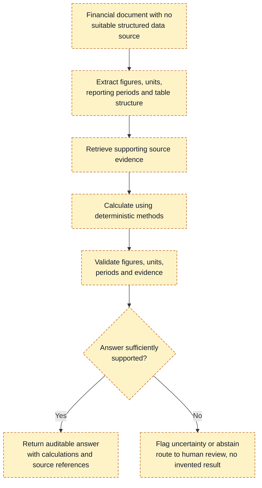

# Technical Analysis

Evidence IDs refer to [../evidence-register.md](../evidence-register.md). Statements about how failures propagate are **reasoned inferences** (`[INF]`) unless an evidence ID is attached.

## 1. The pipeline and how errors propagate

| # | Stage | What can go wrong (financial documents) | Downstream effect | Evidence |
|---|---|---|---|---|
| 1 | Ingestion | Wrong filing/version; scanned or password-protected PDFs; mixed languages | Everything later is built on the wrong source | `[INF]` |
| 2 | Text extraction / OCR | Digit errors in scans (e.g., 8↔3); dropped negative signs or parentheses; header/footer noise | A wrong value looks plausible and survives to the answer | `[INF]`; E22 reports mean structure preservation far below text accuracy across its (non-financial) corpus |
| 3 | Layout & table structure | Merged/multi-line headers lose period-to-column mapping; units ("in thousands") and footnotes detach from numbers; multi-page tables split | Values mapped to wrong period/unit: errors of magnitude or period | `[HYP]` for frequency; E16 shows adjacent-column errors with parsed statements; E13 shows gains from pre-processing |
| 4 | Chunking & metadata | Fixed-size chunks split tables; chunk lacks company/period/unit | Retrieved chunk is un-interpretable or ambiguous | E06 (element-based chunking helps); E14 (overlap helps, excessive granularity does not) |
| 5 | Embedding | Dense vectors blur similar numbers/years and near-duplicate tables across filings | Wrong year or entity retrieved | `[INF]`; E15 reports temporal/entity mismatches |
| 6 | Keyword / semantic / hybrid retrieval | Exact tokens (line items, tickers) missed by dense search; semantic search misses numerics | Missing evidence | E14 found retriever choice matters, with sparse-hybrid and late-interaction models doing best on different query types (as stated in the paper) |
| 7 | Reranking | Optional; may promote text over tables | Table evidence dropped | `[GAP]` not evaluated here |
| 8 | Context assembly | Order and position effects; tables flattened to text | Evidence ignored ("lost in the middle") | E11; E04 (filing-first prompt raised GPT-4-Turbo from 25% to 78%, SNIP) |
| 9 | LLM generation | Wrong column; arithmetic slip; confident claim without evidence | Wrong final answer | E16, E01, E02, E09 |
| 10 | Citation & evidence verification | Citations present but unsupportive | False assurance | E10 (74.5% citation precision), E09 |
| 11 | Deterministic calculation | Correct arithmetic on wrong inputs | Precise but wrong answer | `[INF]` (see §3) |
| 12 | Uncertainty handling & review | Over-confident output, or over-abstention | Missed errors or low utility | E17 mentions "calibrated trust" as analyst feedback; calibration itself not evaluated here |

**Error compounding.** If stages were independent with per-stage success probabilities p1…pn, end-to-end success would be their product. Real stages are not independent, and I have no measured p values, so this is only a reminder that small per-stage losses compound. It is not an estimate.

## 2. Relative contribution: what is and isn't known

- Fin-RATE (E15) was designed to separate retrieval, generation, reasoning and query-misreading errors via a 13-type taxonomy; I read only its abstract/introduction, not the error breakdown tables. `[GAP]`
- The controlled parsing/chunking study (E14) found parser and retriever choice matter but cheap combinations often rival complex ones. That counters an assumption that structure-aware parsing is the main lever, while that study did not include a table-structure-recognition parser such as Docling (it did include Unstructured, which uses model-based layout detection). `[CON]`
- Whole-system results (E17: 89.3% FinanceBench) imply the combination of techniques can work; the attribution among techniques is not available from the abstract.
- Embeddings are not established as the main failure source. Nothing I read isolates embedding quality, and the instruction not to assume it is respected: the evaluation plan ablates it.

**Conclusion.** The relative contribution of parsing vs chunking vs retrieval vs reasoning vs verification is **unknown** from the evidence in hand and is the central question the proposed experiment would answer.

## 3. Deterministic tooling vs LLM

| Task | Better as deterministic code? | Where the LLM adds value | Limits / failure modes |
|---|---|---|---|
| Arithmetic, ratios, growth rates, margins | Yes. Exactly reproducible. Supported by E07/E08 for 2022-era models (margin for current models unmeasured) | Choosing *which* formula the question implies; explaining result | Correct math on wrong inputs; formula definitions differ (e.g., EBITDA, adjusted measures) |
| Reconciliation of structured records | Yes | Mapping differently named line items to a schema | Mapping errors are silent; need review of mapping |
| Date/period normalization (fiscal vs calendar) | Yes, with a rules table | Reading "fiscal 2024 ended Sept 28" from text | Company-specific calendars; 52/53-week years |
| Currency/unit normalization | Yes | Detecting "in thousands" / currency in headers or footnotes | If detection fails, error is orders of magnitude |
| Duplicate detection | Yes (hashing, fuzzy match) | Near-duplicates across restated documents | Restatements are legitimate differences, not duplicates |
| Rule-based consistency checks (subtotals sum, balance sheet identity, cross-statement links) | Yes. Strong error detector for extracted tables `[INF]` | Proposing which checks apply | Rounding tolerances; checks cannot detect consistent-but-wrong values (e.g., wrong year read for every line) |
| Database queries | Yes for structured stores | Text-to-query translation | Wrong query silently returns plausible rows; use read-only constrained schemas |
| Business-rule validation | Yes | Rule authoring support | Rules incomplete or outdated |
| Question interpretation | LLM | Yes | Ambiguity: needs clarification or abstention |
| Document classification, irregular-layout extraction | LLM or vision model | Yes | Needs evaluation per layout class; error can be silent |
| Explanations of verified results | LLM | Yes | May embellish; constrain to verified fields |

**Caveat the task statement requires:** deterministic calculation does not guarantee a correct answer when source data, extraction, business rules or record selection are wrong. The design therefore pairs calculation with (a) validation of extracted inputs (sums, identities, cross-period continuity), (b) display of the exact inputs used with page references, and (c) abstention or review when checks fail.

## 4. Safe-design controls

| Control | Rationale | Limits / what remains unproven |
|---|---|---|
| Page-level (ideally bounding-box) provenance for every extracted value | Lets a reviewer verify in seconds | Provenance can be wrong if extraction misaligned; must be tested (citation-support metric) |
| Validation of extracted values (sum checks, identity checks, period continuity) | Catches many structural errors `[INF]` | Cannot catch consistently wrong values; coverage rate unmeasured |
| Explicit units, currency, period, basis (GAAP/adjusted, restated) as required fields | Prevents magnitude/period errors | Requires reliable detection |
| Confidence thresholds | Gate review/abstention | **Scores must not be presented as probabilities unless calibration is tested** (reliability diagrams/ECE on held-out data). Until then, call them "uncalibrated scores" |
| Abstention when evidence insufficient | Avoids confident wrong answers | Trade-off with coverage; threshold must be chosen from measured curves |
| Human review for ambiguous or high-impact output | Retains accountability | Review effort is the cost being reduced; automation bias risk (reviewers rubber-stamp) `[INF]` |
| Access permissions and per-matter data isolation | Confidentiality in multi-client firms | Not evaluated; standard engineering practice |
| Prompt-injection defenses: treat documents as untrusted data, segregate from instructions, validate outputs deterministically, least privilege, no autonomous consequential actions, adversarial testing (E26) | Indirect injection through uploaded files is the main LLM01 vector | OWASP states no fool-proof prevention exists; controls reduce impact only |
| Logging and reproducibility (store document hash, parser version, prompts, model ID, retrieved chunk IDs, outputs) | Audit trail; reproduce an answer | LLM nondeterminism: pin versions, set temperature low, record outputs; exact reproducibility of hosted models is not guaranteed |
| No consequential actions (payments, filings) | Limits blast radius | Product scope decision |
| Local/self-hosted option for sensitive documents | Avoids sending data to third parties | Quality may be lower with smaller local models (E14: larger LLMs improve correctness, with gains leveling beyond medium size) |

Security, privacy and financial correctness are treated as **core requirements**, not features. Any prototype must have a written threat model before it handles non-public documents. No threat model, penetration test or compliance review has been done here.

## 5. Trade-offs

- **Reliability vs coverage:** stricter validation raises abstention. Acceptable abstention depends on user tolerance, an open question.
- **Reliability vs cost/latency:** VLM-based parsing and verification passes add per-page and per-query cost (see [economic-model](economic-model.md)). Cheap parsers were competitive in E14, so the added cost needs evidence of benefit.
- **Long context vs retrieval:** long-context models reduced retrieval failures in E04 but the authors considered this impractical for large corpora (latency, document size); E05 shows very long filings remain hard.
- **Agentic loops vs auditability:** multi-step agents (E17) may improve accuracy but make traces longer to verify.

## 6. Technical conclusion

Structure-aware parsing, table-aware chunking, deterministic calculation and verification are each supported by *some* evidence and each has a credible failure mode. The evidence does not yet show that the **combination** beats a strong baseline by a margin that matters, nor which part drives it. The experiment in [evaluation-plan](evaluation-plan.md) is designed to answer that.

## 7. Proposed conceptual workflow (not an implemented system)

**This is a proposed conceptual workflow. No part of it has been built, tested or evaluated.** It shows how the controls in sections 3 and 4 would fit together for the narrowed use case: financial documents with no suitable structured data source. It deliberately omits technology choices, because the research does not justify specific components. Those are what the [evaluation plan](evaluation-plan.md) would test.

How to read it:

- **Extract, retrieve:** failures here are the parsing and retrieval failures in section 1. Whether they dominate end-to-end error is unknown (section 2).
- **Calculate, validate:** deterministic arithmetic cannot fix wrong inputs (section 3), so validation checks the extracted values, units and periods before an answer is accepted.
- **Decision branch:** an unsupported answer is flagged or abstained on, not guessed. Any threshold for "sufficiently supported" must come from measured results and is not a calibrated probability (section 4).
